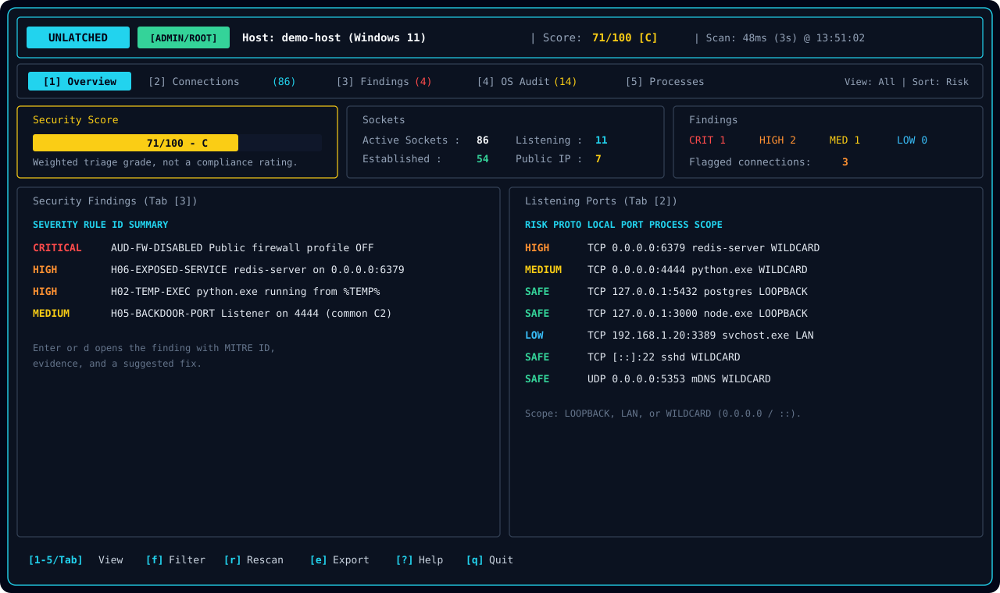

# Unlatched

[](https://www.rust-lang.org/)
[](LICENSE)
[](#install)
[-tested-FCC624?logo=linux&logoColor=black)](#install)

Unlatched shows which program owns each network connection on your computer. It flags connections that look like remote command shells, programs started from temp folders, services open to the whole network, and common ways malware keeps running after a restart.

It runs on the computer you want to check. It does not scan other machines.



## Status

- **Windows 11:** tested.
- **Linux:** tested on WSL (Windows Subsystem for Linux). Reports from other distributions are welcome.
- **macOS:** not supported.

## What it checks

Each connection shows the program, its process ID (PID, the number the system gives a running program), the full command line, the chain of parent programs, the file's SHA-256 fingerprint, and the remote host name when one is found.

| ID | What it flags |
| :--- | :--- |
| `H01` | A command shell (`cmd`, PowerShell, `bash`, `sh`) or a network relay tool (`nc`, `ncat`, `socat`) holds a connection. Also short scripts that open a remote shell. |
| `H02` | A program runs from a temp folder, a shared folder, or the Recycle Bin. |
| `H03` | A program runs from a file that was deleted or exists only in memory. |
| `H04` | A program pretends to be a system process, such as a fake `svchost.exe` outside the Windows system folder. |
| `H05` | A connection uses a port often tied to remote-access tools, crypto miners, or botnets, such as `4444` or `31337`. |
| `H06` | A remote-access or database service listens on all network interfaces. Also a web or database server that starts a command shell. |
| `H07` | A PowerShell command hides its payload, downloads and runs code, or misuses a Windows tool to run remote code. |

`H05` checks the port number only. A legitimate program on port 4444 gets flagged, so check the program path before you stop it.

The scan also reads the hosts file. An entry that sends an update or antivirus domain to another address is Critical. An entry that blocks it by pointing it to `0.0.0.0` is a Warning, because many blocklists do that.

**Windows also checks:** firewall profiles, programs that start at sign-in (Run keys and Startup folders), and the Winlogon shell.

**Linux also checks:** the firewall (ufw or nftables), `/etc/ld.so.preload`, cron and `rc.local` entries, root and empty-password logins in `sshd_config`, and `ExecStart` lines in systemd service files.

The header shows a score from 0 to 100. Each finding lowers it. The score counts findings only. It does not measure how secure the computer is.

## Install

### Windows

Install Rust with [rustup](https://rustup.rs/). Choose the MSVC toolchain, which needs the Visual Studio C++ build tools. Then run:

```powershell
git clone https://github.com/Narden91/unlatched.git
cd unlatched
cargo build --release
```

The program is at `target\release\safe_door_scanner.exe`.

### Linux

Install Rust with [rustup](https://rustup.rs/) or your distribution's package manager. Then run:

```bash
git clone https://github.com/Narden91/unlatched.git
cd unlatched
cargo build --release
```

## Run

Without admin rights the scan still runs. Some process names come back blank, and some checks are skipped. The header shows `No exe path: x/y` when a program path is missing, so you can see how much the scan could not read.

**Windows** (in an Administrator terminal):

```powershell
.\target\release\safe_door_scanner.exe
```

**Linux** (as root):

```bash
sudo ./target/release/safe_door_scanner
```

Run `safe_door_scanner --help` for all options.

## Command-line mode

| Option | Effect |
| :--- | :--- |
| `--cli` | Print a summary and exit |
| `--flagged` | Hide connections that have no findings |
| `--json` | Print the full scan as JSON |
| `--export-md FILE` | Write a Markdown report |
| `--export-json FILE` | Write a JSON report |
| `--diff FILE` | Compare this scan with an earlier JSON report |

```powershell
.\target\release\safe_door_scanner.exe --cli --flagged
.\target\release\safe_door_scanner.exe --cli --export-md unlatched.md --export-json unlatched.json
```

The exit code is `2` when the scan finds at least one Critical item, in every command-line mode. It is `0` otherwise.

If a check fails, for example the list of connections cannot be read, the report shows a warning and the grade reads `INCOMPLETE`.

### Compare with an earlier scan

Save a baseline on a known-good day, then compare later:

```powershell
.\target\release\safe_door_scanner.exe --export-json baseline.json
.\target\release\safe_door_scanner.exe --diff baseline.json
```

The comparison lists:

- new listening ports,
- new programs that hold connections,
- new startup entries,
- programs whose file changed (same path, different SHA-256).

Programs match by file path, not PID. A known program that moves to a new random port (32768 and up) is not reported. Run both scans with the same rights.

## Keys in the terminal window

| Key | Action |
| :--- | :--- |
| `1` to `5`, `Tab`, `Shift+Tab` | Switch tabs: Overview, Connections, Findings, Audit, Processes |
| `Up` / `Down`, `j` / `k` | Move the selection |
| `PgUp` / `PgDn` | Jump 10 rows |
| `f` | Filter connections: All, Listening, Established, Public IP, Flagged |
| `s` | Sort: Risk, Port, Process, State, PID |
| `/` | Search the current table |
| `r` | Scan now. The scan runs in the background, and the screen stays responsive |
| `a` | Auto-refresh every 3 s or 10 s, or pause |
| `e` | Write `safe_door_report.json` and `safe_door_report.md` |
| `Enter`, `d` | Show details |
| `?`, `h` | Show help |
| `q`, `Esc` | Close a window, clear the search, or quit |

A `+` before a process name in the Connections tab marks a listening port that did not exist when the window opened.

## Running with admin rights safely

Anyone who can write to a folder can replace the program in it. If you run that copy as Administrator or root, they get those rights too.

Copy the program to a folder that only administrators can write to, then run the copy:

- Windows: `C:\Program Files\Unlatched\`
- Linux: `/usr/local/bin/`

The program also protects itself in these ways:

- It starts its helper tools (`nslookup` on Windows, `getent` on Linux) by full path. A fake copy in the program's folder is not run.
- On Windows it loads its system libraries from the Windows system folder only. This does not cover libraries it loads while it runs.
- It shows unusual characters in names as escape text, such as `\u{1b}`. A process name cannot change what your terminal displays. The same applies to the JSON and Markdown reports.
- It writes each report to a new file and then renames it into place. A link placed at the report name is replaced, not followed.

## What it does not do

- It does not prove that a computer is clean. It reports patterns. An attacker can rename programs or use methods these rules do not cover.
- It checks one computer only. It does not scan your network.
- `H05` uses port numbers only, so it produces false alarms on legitimate programs.
- Some reverse DNS names stay empty. A one-shot run waits up to 2 seconds for them.
- Some results need admin rights. Without them, the report is incomplete, and the header says so.
- The score is a count of findings, not a security grade.

## License

[MIT](LICENSE)
