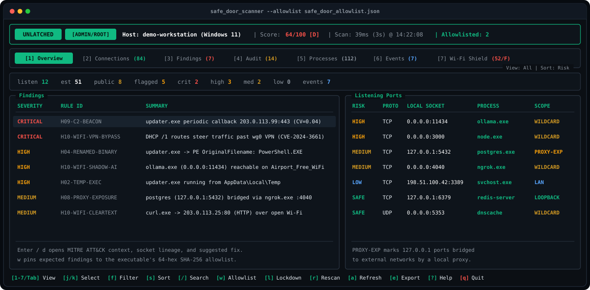

# Unlatched

[](https://www.rust-lang.org/)
[](LICENSE)
[](#install)
[-tested-FCC624?logo=linux&logoColor=black)](#install)

Unlatched shows which local program owns each open TCP and UDP socket on your machine. For every connection, it brings together the process ID, file path, command line, parent process chain, on-disk SHA-256 hash, Windows PE `OriginalFilename`, network reachability, and validated reverse-DNS hostname in a single terminal view or one-off report.

All data stays on the machine being inspected. Unlatched never scans other hosts and never modifies network or firewall settings on its own. It flags patterns worth checking rather than hard proof of compromise, so a clean run does not guarantee a system is secure.



## Status

- **Windows 11:** tested.
- **Linux:** tested on WSL (Windows Subsystem for Linux). Reports from other distributions are welcome.
- **macOS:** not supported.

## Key capabilities

### Public Wi-Fi check and reversible firewall script (`--wifi-shield`, `--export-lockdown`)

Laptops on hotel, airport, cafe, or shared office Wi-Fi often carry dev servers or local AI tools bound to `0.0.0.0` without authentication. `--wifi-shield` (or tab `7` in the TUI) checks both the wireless link and what your machine opens to neighbors on that subnet:

- **Wireless link security:** checks authentication and cipher suites (`WPA3-SAE`, `WPA2`, `OWE`, open, `WEP`, `TKIP`) and flags mid-session encryption downgrades for a previously seen SSID.
- **Local link tampering:** checks the ARP table for a gateway MAC address shared with another host on the subnet, and flags `/1` routes (`0.0.0.0/1` and `128.0.0.0/1`) that steer traffic around an active VPN (`CVE-2024-3661`).
- **Firewall and DNS configuration:** flags Windows `Private` or `Domain` firewall profiles active on open or guest networks, disabled host firewalls, and DHCP-assigned DNS resolvers when encrypted public resolvers (`1.1.1.1`, `8.8.8.8`, `9.9.9.9`, OpenDNS, AdGuard) are not configured.
- **Local AI and dev ports on all interfaces:** flags unauthenticated tools listening on `0.0.0.0` or `::`, including Ollama (`11434`), LM Studio (`1234`), Open WebUI and MCP servers (`3000`, `3001`), Qdrant (`6333`), Gradio (`7860`), vLLM (`8000`), `llama.cpp` (`8080`), ComfyUI (`8188`), Ray (`8265`), Jupyter (`8888`), and Android ADB (`5555`).
- **Unencrypted outbound traffic:** flags active cleartext connections (`HTTP`, `FTP`, `Telnet`, `SMTP`, `POP3`, `IMAP`, `MQTT`, `Redis`) while connected to untrusted Wi-Fi.

`--export-lockdown FILE` (or `l` in the TUI) writes a 7-bit ASCII PowerShell (`.ps1`) or POSIX shell (`.sh`) firewall script that switches the active profile to `Public` and blocks inbound traffic on non-loopback ports. Each generated script includes a `-Rollback` / `--rollback` flag that removes only the rules it added. Unlatched writes the file for you to inspect and never executes it automatically.

### Live watch mode and callback timing (`--watch`, `H09`)

`--watch SECS` (and tab `6` in the TUI) keeps a 256-entry ring buffer of opened and closed sockets, new listeners, and on-disk executable SHA-256 changes across consecutive scans.

During live monitoring, Unlatched tracks inter-arrival times between repeated outbound external connections per `(executable, remote_ip, remote_port)` tuple with Welford's online variance formula. It flags regular low-jitter callbacks (`H09-C2-BEACON`) once $n \ge 4$ intervals with mean $\mu \ge 1.0\text{ s}$ and coefficient of variation $CV = s/\mu \le 0.20$ are observed.

### Proxy-bridged loopback ports (`H08`) and renamed Windows binaries (`H04`)

- **Loopback proxy paths (`H08`, `PROXY-EXP`):** a service bound to `127.0.0.1` or `[::1]` can still be reachable from other machines if a reverse proxy, port forwarder, or tunnel on the same host bridges traffic to it. Unlatched correlates local socket pairs to flag loopback listeners linked to a network-facing process.
- **Renamed PE binaries (`H04-RENAMED-BINARY`):** on Windows, Unlatched parses the embedded `VS_VERSION_INFO` `OriginalFilename` resource from the executable on disk so copied and renamed system tools (for example, `powershell.exe` renamed to `updater.exe`) are still identified.

### SHA-256 allowlist, baseline diffs, and SARIF 2.1.0 output

- **Hash-pinned allowlist (`--allowlist FILE`, TUI `w`):** hides expected findings only while the binary on disk matches a full 64-character hex SHA-256 hash (with optional rule ID prefix and local port). Modifying or replacing the file changes its hash and restores the finding automatically.
- **Baseline comparison (`--diff FILE`):** compares the live machine against an earlier `--export-json` snapshot and lists new listeners, listener scope changes (such as `127.0.0.1` widened to `0.0.0.0`), new findings, new startup entries, and modified binaries.
- **Report formats (`--export-md`, `--export-json`, `--export-sarif`, TUI `e`):** writes Markdown, JSON, and OASIS SARIF v2.1.0 reports for code-scanning viewers or ticket attachments.

## Detection rules

| ID | What it flags |
| :--- | :--- |
| `H01` | Interactive shells (`cmd`, PowerShell, `bash`, `sh`) or raw relays (`nc`, `ncat`, `socat`) holding network sockets, including inline interpreter reverse shells and renamed shell binaries. |
| `H02` | Programs running from temporary, shared-memory, or world-writable directories (`/tmp`, `/dev/shm`, `%TEMP%`, `Users\Public`, Recycle Bin). |
| `H03` | Programs running from deleted on-disk binaries or Linux `memfd:` descriptors. |
| `H04` | System process spoofing: fake paths (including `System32` subdirectories), typosquatted names, fake Linux kernel threads, and renamed Windows PE utilities (`H04-RENAMED-BINARY`). |
| `H05` | Listeners or outbound connections on ports commonly used by remote administration tools, reverse shells, or mining pools (`4444`, `31337`, `1337`, `5555`, `2375`, etc.). |
| `H06` | Databases and internal services bound to `0.0.0.0` or `::`, plus shells started beneath a web or database server process tree. |
| `H07` | Encoded PowerShell arguments (`-e`, `-enc`, `-encodedcommand`), download commands, `/dev/tcp`, `curl \| sh`, and Windows scriptlet runners. |
| `H08` | Loopback listeners (`127.0.0.1` / `[::1]`) bridged to the network by a local reverse proxy, tunnel, or port-forwarding process (`PROXY-EXP`). |
| `H09` | Outbound external connections repeating at regular intervals across live scans ($n \ge 4$ intervals, $\mu \ge 1.0\text{ s}$, $CV = s/\mu \le 0.20$). |
| `H10` | Open/WEP/TKIP Wi-Fi links, mid-session SSID encryption downgrades, duplicate ARP gateway MACs, `Private` firewall profiles on guest networks, untrusted DNS resolvers, `/1` VPN-bypass routes (`CVE-2024-3661`), local AI/dev servers on `0.0.0.0`, and cleartext outbound traffic. |

### Host startup and firewall checks

- **Windows:** Defender Firewall profile states (including Group Policy overrides), Registry `Run` and `RunOnce` entries, Registry-resolved `Startup` folders, and Winlogon `Shell` and `Userinit` values.
- **Linux:** `ufw` and netfilter state, `/etc/ld.so.preload`, `/etc/crontab`, `/etc/cron.d/*`, `/etc/rc.local`, `sshd_config` (`PermitRootLogin`, `PermitEmptyPasswords`), and systemd `ExecStart` units.
- **Hosts file:** entries redirecting OS update or antivirus domains to external IPs are flagged as `Critical`; `0.0.0.0` and loopback ad-block lists are grouped into a single `Warning` item.

## Install

### Windows

Install Rust (`>= 1.94`) with [rustup](https://rustup.rs/) and the MSVC toolchain:

```powershell
git clone https://github.com/Narden91/unlatched.git
cd unlatched
cargo build --release
```

The compiled binary is written to `target\release\safe_door_scanner.exe`.

### Linux

```bash
git clone https://github.com/Narden91/unlatched.git
cd unlatched
cargo build --release
```

The compiled binary is written to `target/release/safe_door_scanner`.

## Command-line mode

Running `safe_door_scanner` with no flags opens the interactive terminal UI. Pass any option below for non-interactive output:

| Option | Effect |
| :--- | :--- |
| `--cli` | Print a terminal summary and exit |
| `--flagged` | Show only flagged sockets in `--cli` output |
| `--json` | Print the full `ScanSnapshot` as JSON to stdout |
| `--export-md FILE` | Write a sanitized Markdown report |
| `--export-json FILE` | Write a JSON snapshot file |
| `--export-sarif FILE` | Write an OASIS SARIF v2.1.0 report |
| `--diff FILE` | Compare against an earlier `--export-json` baseline |
| `--allowlist FILE` | Hide findings matching 64-hex SHA-256 rules in `FILE` |
| `--watch SECS` | Poll every `SECS` seconds, printing socket events and `H09` callback alerts |
| `--watch-cycles N` | Stop `--watch` mode after `N` scan cycles |
| `--wifi-shield` | Check the active Wi-Fi link, routing table, DNS, and network-reachable local ports |
| `--export-lockdown FILE` | Write a 7-bit ASCII firewall lockdown script (`.ps1` on Windows, `.sh` on Linux) with rollback support |

```powershell
# Save a trusted baseline, then compare later
.\target\release\safe_door_scanner.exe --export-json baseline.json
.\target\release\safe_door_scanner.exe --cli --diff baseline.json

# Check public Wi-Fi risks and write a reviewable firewall script
.\target\release\safe_door_scanner.exe --wifi-shield --export-lockdown wifi_lockdown.ps1

# Watch socket changes every 5 seconds with a SHA-256 allowlist
.\target\release\safe_door_scanner.exe --watch 5 --allowlist safe_door_allowlist.json

# Triage flagged sockets and write a SARIF 2.1.0 report
.\target\release\safe_door_scanner.exe --cli --flagged --export-sarif results.sarif.json
```

The process exits with code `2` when at least one unsuppressed `Critical` finding is present, and `0` otherwise.

## Keys in the TUI

| Key | Action |
| :--- | :--- |
| `1` to `7`, `Tab`, `Shift+Tab` | Switch views: `Overview`, `Connections`, `Findings`, `Audit`, `Processes`, `Events`, `Wi-Fi Shield` |
| `Up` / `Down`, `j` / `k`, `PgUp` / `PgDn` | Move selection up or down |
| `f` | Cycle connection filter (`All`, `Listening`, `Established`, `Public IP`, `Flagged`) |
| `s` | Cycle connection sort (`Risk`, `Port`, `Process`, `State`, `PID`) |
| `/` | Filter the active table by substring |
| `w` | Add the selected binary's SHA-256 hash to `safe_door_allowlist.json` |
| `l` | Write a reversible firewall lockdown script (`safe_door_wifi_lockdown.ps1` or `.sh`) |
| `r` | Run an immediate background scan |
| `a` | Cycle auto-refresh interval (`3s`, `10s`, `Paused`) |
| `e` | Write `safe_door_report.json`, `safe_door_report.md`, and `safe_door_report.sarif.json` |
| `Enter`, `d` | Open the detail modal for the selected row |
| `?`, `h` | Open the keyboard and rule reference modal |
| `q`, `Esc` | Close modal, clear search, or quit |

## Running with administrator or root privileges

Copy the release binary into an administrator-owned folder (`C:\Program Files\Unlatched\` on Windows, `/usr/local/bin/` on Linux) before running it as administrator or `root`. Built-in self-protection checks include:

- **Local-only file reads:** rejects Windows UNC and device paths (`\\server\share`, `\\.\`), opens files without following symlinks or NTFS reparse points (`FILE_FLAG_OPEN_REPARSE_POINT` on Windows, `lstat == fstat` inode checks on Unix), and caps read sizes.
- **Restricted child execution and DLL loading:** Windows `build.rs` sets `/DEPENDENTLOADFLAG:0x800` (`LOAD_LIBRARY_SEARCH_SYSTEM32`); external commands run by absolute system path with cleared environment variables, bounded output buffers, and strict timeouts.
- **Output escaping:** control characters, ANSI escape sequences, and Unicode bidirectional overrides are stripped or escaped before writing to the terminal, Markdown, JSON, SARIF, or lockdown scripts.
- **Atomic file writes:** report and script writers verify that parent directories are not symlinks or junctions, write to a temporary file (`0600` permissions on Unix), and rename into place.
- **Hash-pinned suppression:** allowlist entries require a 64-character hex SHA-256 hash, so replacing or altering an allowlisted binary on disk invalidates the suppression rule.

## License

[MIT](LICENSE)
