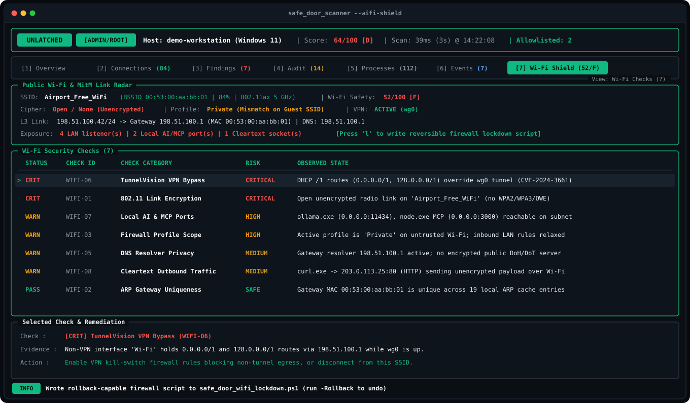
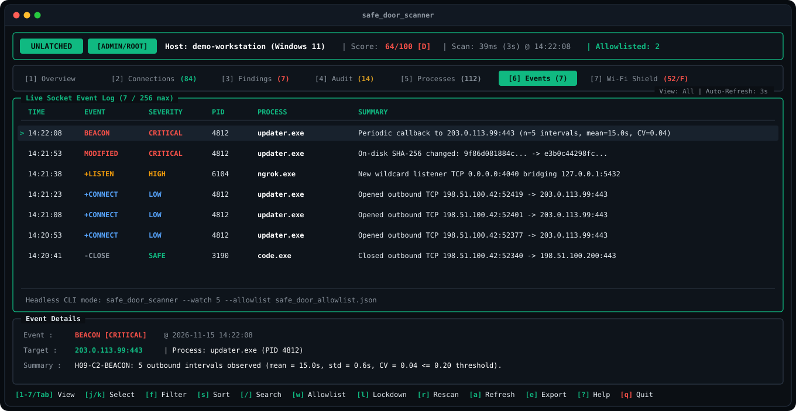
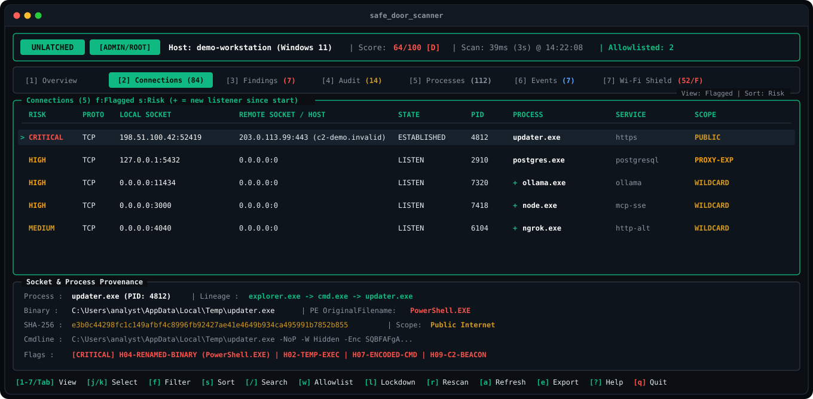
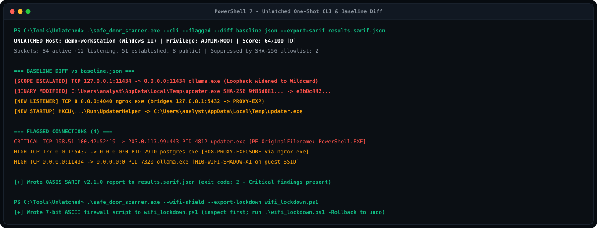
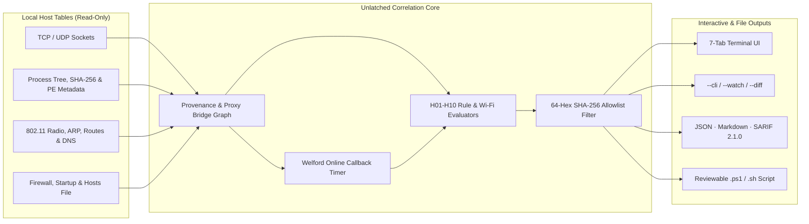

<div align="center">

# Unlatched

**Local socket provenance, process lineage, public Wi-Fi link inspection, and host persistence checks in one terminal view.**

[](https://www.rust-lang.org/)
[](LICENSE)
[](#install)
[](#install)
[](#baseline-diffs-sha-256-allowlist-and-sarif-210-output)
[](#running-with-administrator-or-root-privileges)

[**Visual Tour**](#visual-tour) · [**Architecture**](#architecture) · [**Detection Rules**](#detection-rules) · [**Install**](#install) · [**CLI Mode**](#command-line-mode) · [**TUI Shortcuts**](#keys-in-the-tui) · [**Admin Safety**](#running-with-administrator-or-root-privileges)

</div>

<br/>

<p align="center">
  
</p>

> [!NOTE]
> **Local-only and read-only by default.** Default host-inspection modes inspect only the machine where Unlatched runs and never modify OS or firewall settings automatically. The optional `--wifi-map` interface offers explicit LAN discovery through its Scan network button. Findings flag patterns worth investigating rather than hard proof of compromise, so a clean run does not guarantee a system is secure.
> *(All screenshots in this repository use RFC 5737 and RFC 7042 documentation addresses on a fictional `demo-workstation` host.)*

---

## At a Glance

<table>
  <tr>
    <td width="50%" valign="top">
      <h3>Public Wi-Fi Shield &amp; Lockdown</h3>
      <p>Checks 802.11 cipher strength, mid-session SSID downgrades, duplicate ARP gateway MACs, <code>/1</code> VPN-bypass routes (<code>CVE-2024-3661</code>), <code>Private</code> firewall profile mismatches, cleartext traffic, and local AI/MCP ports (<code>11434</code>, <code>3000</code>, <code>1234</code>, <code>8000</code>, <code>8888</code>) bound to <code>0.0.0.0</code>. Writes a reviewable <code>.ps1</code> or <code>.sh</code> firewall script with built-in rollback.</p>
    </td>
    <td width="50%" valign="top">
      <h3>Live Socket Watch &amp; Callback Timing</h3>
      <p>Maintains a 256-entry ring buffer of opened and closed sockets, new listeners, and on-disk binary SHA-256 changes across scan intervals (<kbd>6</kbd> in the TUI or <code>--watch SECS</code>). Flags low-jitter periodic outbound callbacks (<code>H09-C2-BEACON</code>) with Welford's online variance algorithm.</p>
    </td>
  </tr>
  <tr>
    <td width="50%" valign="top">
      <h3>Proxy Paths &amp; Renamed PE Binaries</h3>
      <p>Spots <code>127.0.0.1</code> services made reachable to external networks through a local reverse proxy, port forwarder, or tunnel (<code>H08</code> / <code>PROXY-EXP</code>). Parses Windows PE <code>VS_VERSION_INFO</code> <code>OriginalFilename</code> resources to catch copied and renamed system tools (<code>H04-RENAMED-BINARY</code>).</p>
    </td>
    <td width="50%" valign="top">
      <h3>SHA-256 Allowlist, Diffs &amp; SARIF 2.1.0</h3>
      <p>Silences expected findings by pinning a binary's full 64-character hex SHA-256 hash (<kbd>w</kbd> or <code>--allowlist</code>); modifying the file on disk restores the alert automatically. Compares snapshots via <code>--diff</code> and writes Markdown, JSON, and OASIS SARIF v2.1.0 reports.</p>
    </td>
  </tr>
</table>

## Interactive Wi-Fi device map (Windows)

Run `cargo run --locked -- --wifi-map`, then open the printed `http://127.0.0.1:PORT/`
address in your browser. The interface runs locally, needs no additional dependencies
or external assets, and stops when you press Ctrl+C in the terminal.

- Drag or use arrow keys to rotate the 3D view; scroll or use the zoom buttons to zoom.
  Select a device in the map or searchable list to inspect its addresses and evidence.
- **Refresh cache** reads the current Wi-Fi link and its IPv4 neighbor cache. Cache
  entries may be stale. Loading the page does not probe peer devices.
- **Scan network** explicitly sends one source-addressed ICMP echo request per peer
  address on the current Wi-Fi subnet, with 16 workers and a 300 ms reply timeout.
  Active discovery supports `/24` through `/30` subnets (at most 254 host addresses).
  Larger subnets remain available as a cached view. Use active discovery on networks
  you own or administer. Optional reverse DNS uses the configured system resolver;
  unresolved names remain unknown. No ports are scanned.
- Device type guesses use hostname tokens and include their evidence and low
  confidence. Unknown types remain **Unknown**. The gateway label describes its
  routing role, rather than identifying its hardware.
- **The map is schematic, not a physical floor plan.** Positions, bearings, and
  physical distances are unknown. Wi-Fi signal percentage describes the connection
  to the access point; it is not a per-device range measurement. No RSSI or ping
  timing is converted into meters. Physical mapping needs additional ranging or
  measured position data, which this version does not collect.
- Results can include wired devices and miss sleeping or isolated wireless clients.
  A neighbor cache is not a complete router client list. A fresh ICMP reply confirms
  reachability during that scan; lack of a reply does not prove absence.

This mode is separate from the existing host inspection commands. It serves only
the device map on the loopback interface and holds results in memory. If telemetry
is unavailable, check WLAN AutoConfig and Windows Location access for desktop apps.
The existing terminal and report modes retain their local-only behavior.

Checks: `cargo test --locked --offline`. The optional browser regression check uses
Node.js 22 or newer and an already installed Chromium browser, without npm packages:
`node tests/wifi_map_browser.cjs "C:\path\to\chrome.exe"`. It uses fictional devices
and writes desktop and mobile screenshots under `target/wifi-map-browser/`.

## Platform Status

| Platform | Status | Notes |
| :--- | :--- | :--- |
| **Windows 11** | Tested | Full socket, process tree, PE `OriginalFilename`, Defender Firewall, Registry startup, and `netsh wlan` Wi-Fi inspection |
| **Linux** | Tested on WSL | Full `/proc/net`, `/proc/<pid>`, `ufw`/netfilter, `cron`/`systemd`/`sshd_config`, and `nmcli`/`iw` Wi-Fi inspection (reports from native distros welcome) |
| **macOS** | Not supported | Planned |

---

## Visual Tour

### 1. Public Wi-Fi Check and Reversible Firewall Script (<kbd>7</kbd> · `--wifi-shield` · `--export-lockdown`)

Laptops on hotel, airport, cafe, or shared office Wi-Fi frequently carry local AI servers or dev tools bound to `0.0.0.0` without authentication. Tab <kbd>7</kbd> (`Wi-Fi Shield`) and `--wifi-shield` check both the wireless link and what your host opens to neighbors on that subnet:

<p align="center">
  
</p>

- **Wireless link security:** checks authentication and cipher suites (`WPA3-SAE`, `WPA2`, `OWE`, open, `WEP`, `TKIP`) and flags mid-session encryption downgrades on a previously seen SSID.
- **ARP and VPN route tampering:** checks the ARP cache for a gateway MAC shared with another host on the subnet, and flags DHCP-injected `/1` routes (`0.0.0.0/1` and `128.0.0.0/1`) that steer traffic past an active VPN interface (`CVE-2024-3661`).
- **Firewall and DNS configuration:** flags Windows `Private` or `Domain` firewall profiles active on guest networks, disabled host firewalls, and unencrypted gateway DNS resolvers when public DoH/DoT resolvers (`1.1.1.1`, `8.8.8.8`, `9.9.9.9`, OpenDNS, AdGuard) are absent.
- **Local AI and dev servers on all interfaces:** flags unauthenticated listeners on `0.0.0.0` or `::`, including Ollama (`11434`), LM Studio (`1234`), Open WebUI and MCP servers (`3000`, `3001`), Qdrant (`6333`), Gradio (`7860`), vLLM (`8000`), `llama.cpp` (`8080`), ComfyUI (`8188`), Ray (`8265`), Jupyter (`8888`), and Android ADB (`5555`).
- **Unencrypted outbound connections:** flags active cleartext sockets (`HTTP`, `FTP`, `Telnet`, `SMTP`, `POP3`, `IMAP`, `MQTT`, `Redis`) while connected to untrusted Wi-Fi.

Pressing <kbd>l</kbd> in the TUI or passing `--export-lockdown FILE` writes a 7-bit ASCII PowerShell (`.ps1`) or POSIX shell (`.sh`) firewall script for your review. Unlatched never runs the script on its own.

<details>
<summary><strong>Preview sample generated PowerShell firewall script (<code>wifi_lockdown.ps1</code>)</strong></summary>

```powershell
# Generated by Unlatched (--export-lockdown). Inspect before running as Administrator.
# Apply lockdown : .\wifi_lockdown.ps1
# Undo lockdown  : .\wifi_lockdown.ps1 -Rollback
param([switch]$Rollback)
$ErrorActionPreference = 'Stop'
$RuleGroup = 'UnlatchedPublicWifiLockdown'

if ($Rollback) {
    Get-NetFirewallRule -Group $RuleGroup -ErrorAction SilentlyContinue | Remove-NetFirewallRule
    Write-Host "[+] Removed all $RuleGroup firewall rules."
    exit 0
}

Set-NetConnectionProfile -InterfaceAlias 'Wi-Fi' -NetworkCategory Public
New-NetFirewallRule -DisplayName 'Unlatched Block Non-Loopback TCP' -Group $RuleGroup `
    -Direction Inbound -Action Block -Protocol TCP -LocalPort '11434','3000','4040' -Profile Public
```

</details>

---

### 2. Live Socket Watch and Callback Timing (<kbd>6</kbd> · `--watch` · `H09`)

Tab <kbd>6</kbd> (`Events`) and `--watch SECS` record opened sockets, closed sockets, new listeners, and on-disk executable SHA-256 changes across consecutive scans in a bounded 256-event ring buffer.

<p align="center">
  
</p>

To spot automated command-and-control heartbeats without capturing packet payloads, Unlatched tracks inter-arrival times $\Delta t$ per `(executable, remote_ip, remote_port)` tuple in $O(1)$ memory using Welford's online variance algorithm. It raises `H09-C2-BEACON` once $n \ge 4$ intervals with mean $\mu \ge 1.0\text{ s}$ and coefficient of variation $CV = s/\mu \le 0.20$ are observed.

---

### 3. Socket Provenance, Proxy Paths, and Renamed Binaries (<kbd>2</kbd> · `H08` · `H04`)

Tab <kbd>2</kbd> (`Connections`) joins every open TCP and UDP socket with its process lineage, command line, on-disk SHA-256 hash, network reachability, and reverse-DNS hostname:

<p align="center">
  
</p>

- **Loopback proxy paths (`H08`, `PROXY-EXP`):** services bound to `127.0.0.1` or `[::1]` can still be reached from external networks when a local reverse proxy, port forwarder, or tunnel bridges traffic to them. Unlatched correlates local socket pairs to flag loopback listeners linked to a network-facing process.
- **Renamed Windows PE binaries (`H04-RENAMED-BINARY`):** parses the embedded `VS_VERSION_INFO` `OriginalFilename` field from Windows executables on disk so copied and renamed system utilities (such as `powershell.exe` renamed to `updater.exe`) are still caught.

---

### 4. Baseline Diffs, SHA-256 Allowlist, and SARIF 2.1.0 Output

For headless triage, scheduled checks, or CI runners, Unlatched compares live state against saved JSON baselines, filters known tools by cryptographic hash, and writes Markdown, JSON, and OASIS SARIF v2.1.0 reports:

<p align="center">
  
</p>

<details>
<summary><strong>Preview sample SHA-256 allowlist file (<code>safe_door_allowlist.json</code>)</strong></summary>

```json
{
  "rules": [
    {
      "sha256": "9f86d081884c7d659a2feaa0c55ad015a3bf4f1b2b0b822cd15d6c15b0f00a08",
      "rule_id": "H06",
      "local_port": 5432,
      "reason": "Local PostgreSQL dev instance pinned by binary SHA-256"
    }
  ]
}
```

If the binary on disk is updated, modified, or replaced, its 64-character hex SHA-256 hash changes and suppressed findings reappear on the next scan.

</details>

---

## Architecture



---

## Detection Rules

| ID | Default Risk | What it flags |
| :--- | :--- | :--- |
| `H01` | `Critical` | Interactive shells (`cmd`, PowerShell, `bash`, `sh`) or raw relays (`nc`, `ncat`, `socat`) holding sockets, including inline interpreter reverse shells and renamed shell binaries. |
| `H02` | `High` | Programs running from temporary, shared-memory, or world-writable folders (`/tmp`, `/dev/shm`, `%TEMP%`, `Users\Public`, Recycle Bin). |
| `H03` | `Critical` | Programs running from deleted on-disk binaries or Linux `memfd:` memory descriptors. |
| `H04` | `Critical` / `High` | System binary spoofing: fake paths (including `System32` subfolders), typosquatted names, fake Linux kernel threads, and renamed Windows PE utilities (`H04-RENAMED-BINARY`). |
| `H05` | `High` / `Medium` | Listeners or outbound sockets on ports associated with remote access trojans, reverse shells, or mining pools (`4444`, `31337`, `1337`, `5555`, `2375`, etc.). |
| `H06` | `High` | Databases and internal services bound to `0.0.0.0` or `::`, plus shells started under a web or database server parent chain. |
| `H07` | `Critical` / `High` | Encoded PowerShell flags (`-e`, `-enc`, `-encodedcommand`), download commands, `/dev/tcp`, `curl \| sh`, and Windows scriptlet runners. |
| `H08` | `High` / `Medium` | Loopback listeners (`127.0.0.1` / `[::1]`) bridged to external networks by a local reverse proxy, tunnel, or port forwarder (`PROXY-EXP`). |
| `H09` | `Critical` | Outbound external connections repeating at low-jitter intervals across live scans ($n \ge 4$ intervals, $\mu \ge 1.0\text{ s}$, $CV = s/\mu \le 0.20$). |
| `H10` | `Critical` to `Medium` | Open/WEP/TKIP Wi-Fi links, mid-session SSID encryption downgrades, duplicate ARP gateway MACs, `Private` firewall profiles on guest Wi-Fi, untrusted DNS resolvers, `/1` VPN-bypass routes (`CVE-2024-3661`), local AI/dev servers on `0.0.0.0`, and cleartext outbound sockets. |

### Host Startup and Firewall Checks

- **Windows:** Defender Firewall profile states (including Group Policy overrides), Registry `Run` and `RunOnce` entries, Registry-resolved `Startup` folders, and Winlogon `Shell` and `Userinit` values.
- **Linux:** `ufw` and netfilter state, `/etc/ld.so.preload`, `/etc/crontab`, `/etc/cron.d/*`, `/etc/rc.local`, `sshd_config` (`PermitRootLogin`, `PermitEmptyPasswords`), and systemd `ExecStart` units.
- **Hosts file:** entries redirecting OS update or antivirus domains to external IPs are flagged as `Critical`; `0.0.0.0` and loopback ad-block lists are grouped into a single `Warning` item.

---

## Install

### Windows

Install Rust (`>= 1.94`) with [rustup](https://rustup.rs/) and the MSVC toolchain:

```powershell
git clone https://github.com/Narden91/unlatched.git
cd unlatched
cargo build --release
```

The release binary is written to `target\release\safe_door_scanner.exe`.

### Linux

```bash
git clone https://github.com/Narden91/unlatched.git
cd unlatched
cargo build --release
```

The release binary is written to `target/release/safe_door_scanner`.

---

## Command-Line Mode

Running `safe_door_scanner` without arguments launches the interactive TUI. Pass any option below for non-interactive output:

| Option | Effect |
| :--- | :--- |
| `--cli` | Print a terminal summary and exit |
| `--flagged` | Show only flagged sockets in `--cli` output |
| `--json` | Print the full `ScanSnapshot` as JSON to stdout |
| `--export-md FILE` | Write a sanitized Markdown report |
| `--export-json FILE` | Write a JSON snapshot file |
| `--export-sarif FILE` | Write an OASIS SARIF v2.1.0 report |
| `--diff FILE` | Compare against an earlier `--export-json` baseline |
| `--allowlist FILE` | Hide findings matching 64-hex SHA-256 rules in `FILE` |
| `--watch SECS` | Poll every `SECS` seconds, printing socket events and `H09` callback alerts |
| `--watch-cycles N` | Stop `--watch` mode after `N` scan cycles |
| `--wifi-shield` | Check the active Wi-Fi link, routing table, DNS, and network-reachable local ports |
| `--export-lockdown FILE` | Write a 7-bit ASCII firewall lockdown script (`.ps1` on Windows, `.sh` on Linux) with rollback support |

```powershell
# Save a trusted baseline, then compare later (catches 127.0.0.1 -> 0.0.0.0 scope changes)
.\target\release\safe_door_scanner.exe --export-json baseline.json
.\target\release\safe_door_scanner.exe --cli --diff baseline.json

# Check public Wi-Fi risks and write a reviewable firewall script
.\target\release\safe_door_scanner.exe --wifi-shield --export-lockdown wifi_lockdown.ps1

# Watch live socket events every 5 seconds with a SHA-256 allowlist
.\target\release\safe_door_scanner.exe --watch 5 --allowlist safe_door_allowlist.json

# Triage flagged sockets and write a SARIF 2.1.0 report
.\target\release\safe_door_scanner.exe --cli --flagged --export-sarif results.sarif.json
```

> [!TIP]
> **CI and automation exit codes:** Unlatched exits with code `2` when at least one unsuppressed `Critical` finding is present, and `0` otherwise.

---

## Keys in the TUI

| Shortcut | Action |
| :--- | :--- |
| <kbd>1</kbd> .. <kbd>7</kbd> · <kbd>Tab</kbd> · <kbd>Shift</kbd>+<kbd>Tab</kbd> | Switch views: `Overview`, `Connections`, `Findings`, `Audit`, `Processes`, `Events`, `Wi-Fi Shield` |
| <kbd>Up</kbd> / <kbd>Down</kbd> · <kbd>j</kbd> / <kbd>k</kbd> · <kbd>PgUp</kbd> / <kbd>PgDn</kbd> | Move row selection |
| <kbd>f</kbd> | Cycle connection filter (`All`, `Listening`, `Established`, `Public IP`, `Flagged`) |
| <kbd>s</kbd> | Cycle connection sort (`Risk`, `Port`, `Process`, `State`, `PID`) |
| <kbd>/</kbd> | Filter the active table by substring |
| <kbd>w</kbd> | Add the selected binary's 64-hex SHA-256 hash to `safe_door_allowlist.json` |
| <kbd>l</kbd> | Write a reversible firewall lockdown script (`safe_door_wifi_lockdown.ps1` or `.sh`) |
| <kbd>r</kbd> | Trigger an immediate background scan |
| <kbd>a</kbd> | Cycle auto-refresh interval (`3s`, `10s`, `Paused`) |
| <kbd>e</kbd> | Write `safe_door_report.json`, `safe_door_report.md`, and `safe_door_report.sarif.json` |
| <kbd>Enter</kbd> · <kbd>d</kbd> | Open the detail modal for the selected row |
| <kbd>?</kbd> · <kbd>h</kbd> | Open the keyboard and rule reference modal |
| <kbd>q</kbd> · <kbd>Esc</kbd> | Close modal, clear search, or quit |

---

## Running with Administrator or Root Privileges

Copy the release binary into an administrator-owned folder (`C:\Program Files\Unlatched\` on Windows, `/usr/local/bin/` on Linux) before running it as administrator or `root`. Built-in self-protection checks include:

- **Local-only file reads:** rejects Windows UNC and device paths (`\\server\share`, `\\.\`), opens files without following symlinks or NTFS reparse points (`FILE_FLAG_OPEN_REPARSE_POINT` on Windows, `lstat == fstat` inode checks on Unix), and caps read sizes.
- **Restricted child execution and DLL loading:** Windows `build.rs` sets `/DEPENDENTLOADFLAG:0x800` (`LOAD_LIBRARY_SEARCH_SYSTEM32`); external commands run by absolute system path with cleared environment variables, bounded output buffers, and 1.5-second timeouts.
- **Output escaping:** control characters, ANSI escape sequences, and Unicode bidirectional overrides are stripped or escaped before writing to the terminal, Markdown, JSON, SARIF, or lockdown scripts.
- **Atomic file writes:** report and script writers verify that parent directories are not symlinks or junctions, write to a temporary file (`0600` permissions on Unix), and rename into place.
- **Hash-pinned suppression:** allowlist entries require a 64-character hex SHA-256 hash, so replacing or altering an allowlisted binary on disk invalidates the suppression rule.

---

## License

Released under the [MIT License](LICENSE).
