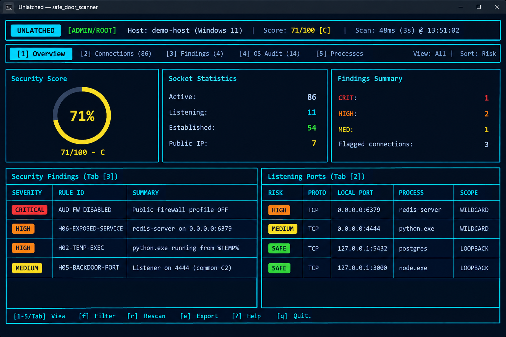

<p align="center">
  <a href="https://www.rust-lang.org/"></a>
  <a href="LICENSE"></a>
  <a href="#windows"></a>
  <a href="#linux"></a>
  <a href="https://github.com/ratatui/ratatui"></a>
  
  <a href="https://github.com/Narden91/safe_door_scanner/stargazers"></a>
</p>

<h1 align="center">Unlatched</h1>

<p align="center"><strong>Local socket inspector and host-security TUI for Linux and Windows.</strong><br>
Binary and crate name: <code>safe_door_scanner</code></p>

<p align="center">
  
  <br>
  <sub>Overview tab. Sample host, not a live capture.</sub>
</p>

Unlatched lists every TCP and UDP socket on the machine you are sitting at, maps it to a PID, and walks the parent chain. A shell owning a socket, `svchost.exe` running from the wrong folder, Redis bound to `0.0.0.0`: each of those lands in the TUI with a rule ID, a MITRE technique, and a suggested fix.

You run it on the host you want to inspect. It does not probe other machines.

The security score is a weighted triage grade from those heuristics. It is not a certification, and it is not antivirus.

## What it checks

Sockets first. Each row carries state, exposure (`127.0.0.1`, LAN, `0.0.0.0`/`::`), owning process, command line, parent lineage, SHA-256 of the on-disk binary, and a background reverse DNS lookup.

Then seven connection and process rules:

| ID | What trips it |
| :--- | :--- |
| `H01` | Interactive shells (`sh`, `bash`, `cmd.exe`, `powershell`) or relays (`nc`, `ncat`, `socat`) bound to a socket, plus inline scripting reverse shells |
| `H02` | Binaries executing from temp or world-writable paths (`/tmp`, `/var/tmp`, `/dev/shm`, `%TEMP%`, `Users\Public`, `$Recycle.Bin`) |
| `H03` | Process image unlinked on disk, or backed by a `memfd` descriptor |
| `H04` | Path spoofing (`svchost.exe` / `lsass.exe` / `csrss.exe` outside `System32`/`SysWOW64`), typosquats, userland binaries posing as Linux kernel threads (`[kworker/...]`) |
| `H05` | Listeners or connections on common backdoor / RAT / C2 / miner ports (`4444`, `31337`, `1337`, `5555`, `2375`, `6666-6669`, `3333`, `14444`) |
| `H06` | Sensitive services (SMB, RDP, Telnet, Redis, MySQL, PostgreSQL, MongoDB, Docker API, VNC) bound to `0.0.0.0`/`::`; web or database servers spawning shells |
| `H07` | Encoded PowerShell (`-EncodedCommand`), download cradles (`IEX`/`DownloadString`), `/dev/tcp` redirects, LOLBin remote script execution (`mshta`, `regsvr32`, `rundll32`) |

`H05` is port-based. A legitimate service on `4444` will still flag. Read the process path before you kill anything.

Host audit is OS-specific. Both sides also inspect the `hosts` file for redirects of update or security domains.

## Windows

Needs a Rust toolchain with the MSVC ABI ([rustup](https://rustup.rs/) plus the Visual Studio C++ build tools). Clone, then from PowerShell:

```powershell
git clone https://github.com/Narden91/safe_door_scanner.git
cd safe_door_scanner
cargo build --release
```

Binary: `target\release\safe_door_scanner.exe`

Open an **Administrator** terminal if you want full kernel socket-to-PID mapping, SHA-256 of system binaries, HKLM Run keys, and Windows Defender Firewall profile state. A standard user still gets a usable scan; some rows will lack a PID and some audit checks will be incomplete.

```powershell
# Interactive TUI
.\target\release\safe_door_scanner.exe

# One-shot summary
.\target\release\safe_door_scanner.exe --cli

# Flagged sockets only
.\target\release\safe_door_scanner.exe --cli --flagged

# Markdown + JSON reports
.\target\release\safe_door_scanner.exe --cli --export-md unlatched.md --export-json unlatched.json

# Raw snapshot on stdout
.\target\release\safe_door_scanner.exe --json
```

Windows audit coverage:

- Defender Firewall Domain / Private / Public profiles (`EnableFirewall` under `HKLM\SYSTEM\CurrentControlSet\Services\SharedAccess\Parameters\FirewallPolicy\...`)
- Autostart: `HKCU`/`HKLM` `Run` and `RunOnce`, plus `HKLM\...\WOW6432Node\...\Run`
- `Winlogon\Shell` (anything other than `explorer.exe` is treated as critical)
- User and common Startup folders
- `C:\Windows\System32\drivers\etc\hosts`

## Linux

Needs `rustc`/`cargo` from [rustup](https://rustup.rs/) or your distro packages. No extra C libraries.

```bash
git clone https://github.com/Narden91/safe_door_scanner.git
cd safe_door_scanner
cargo build --release
```

Binary: `target/release/safe_door_scanner`

Run under **root** (`sudo`) for `/proc` socket owners, `/etc/ld.so.preload`, crontab, sshd, and systemd unit inspection. Unprivileged mode still lists sockets you can see; several audit files will be skipped.

```bash
# Interactive TUI
sudo ./target/release/safe_door_scanner

# One-shot summary
sudo ./target/release/safe_door_scanner --cli

# Flagged sockets only
sudo ./target/release/safe_door_scanner --cli --flagged

# Markdown + JSON reports
sudo ./target/release/safe_door_scanner --cli --export-md unlatched.md --export-json unlatched.json

# Raw snapshot on stdout
sudo ./target/release/safe_door_scanner --json
```

Linux audit coverage:

- UFW (`/etc/ufw/ufw.conf`) and nftables/iptables kernel modules
- `/etc/ld.so.preload`
- `/etc/crontab` and `/etc/rc.local`
- `/etc/ssh/sshd_config` (`PermitRootLogin`, `PermitEmptyPasswords`)
- `/etc/systemd/system/*.service` `ExecStart=` lines
- `/etc/hosts`

macOS is not supported.

## TUI

Launch with no flags. Tabs: Overview, Connections, Findings, OS Audit, Processes.

| Key | Action |
| :--- | :--- |
| `1`–`5`, `Tab`, `Shift+Tab` | Switch tabs |
| `Up` / `Down`, `j` / `k` | Move selection |
| `PgUp` / `PgDn` | Jump 10 rows |
| `f` | Cycle connection filter (All, Listening, Established, Public IP, Flagged) |
| `s` | Cycle sort (Risk, Port, Process, State, PID) |
| `/` | Search the current table |
| `r` | Scan now |
| `a` | Auto-refresh `3s` / `10s` / Paused |
| `e` | Write `safe_door_report.json` and `safe_door_report.md` |
| `Enter`, `d` | Detail modal |
| `?`, `h` | Help |
| `q`, `Esc` | Close modal, clear search, or quit |

## CLI

`--cli` prints a summary and exits. Combine it with `--flagged` to hide clean sockets. `--json` dumps the full snapshot.

Exit code `2` means at least one `CRITICAL` finding. `0` means the scan finished without critical hits (high/medium/low may still be present).

## Limits

Heuristics, not malware signatures. A renamed binary that does not match `H01`–`H07` will sail through. The score can look fine on a host that is already owned.

Firewall and persistence checks read local config; they do not prove the kernel filter is actually dropping packets.

Keep the binary name `safe_door_scanner` if you script against it. Unlatched is the product name.

## License

[MIT](LICENSE)
